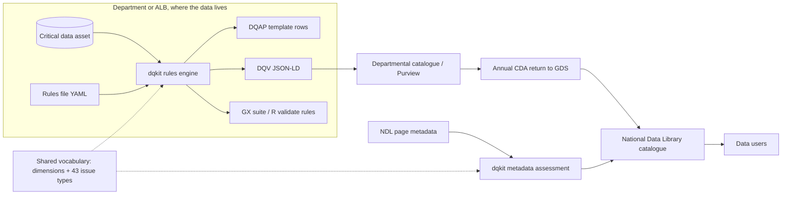

# Architecture: solution, high-level and low-level design

## 1. Solution architecture (SAD)

### Context

### Principles
1. **Data stays with its owner.** The kit runs locally. Only results and metadata move.
2. **One rules file, many outputs.** Steward effort is spent once. Exporters serve other tools.
3. **Standards first:** DCAT, DQV, SKOS, LinkML, JSON Schema, SHACL, ISO 8601, and the GOV.UK issues framework.
4. **Explainable.** Every score carries its evidence, rule and source requirement.
5. **Inclusion by design.** Representativeness is a first-class dimension.

### Fit with the target platform
The recommended production stack (Dataverse, then Fabric, then Purview) can consume DQV JSON-LD as
custom metadata, or map it to Purview data quality rules. The departmental return workspace's Dataverse
table can take the extension's fields as columns (see the LLD mapping).

## 2. High-level design (HLD)

| Component | Responsibility | Interfaces |
|---|---|---|
| `framework.py` | GOV.UK issues framework: targets, bands, priority, resolution | `assess(importance, impact, performance, target)` |
| `rules.py` | Load and validate rule files; run 15 check types on a DataFrame; summarise | `load_rules`, `run(df, spec, as_of)` |
| `metadata.py` | 20 requirement checks on catalogue records; 13 CDA properties; portfolio scoring | `assess_record`, `assess_portfolio` |
| `dqv.py` | Results to W3C DQV JSON-LD | `result_to_dqv` |
| `exporters.py` | Great Expectations, R validate, DQAP CSVs | `to_great_expectations`, `to_r_validate`, `to_dqap_csv` |
| `cli.py` | Plain command line | `check` (with `--workbook`, `--history`), `export`, `assess-metadata` |
| `trust.py` | IOPC-style trust level, with reasons | `classify(result)` |
| `pathway.py` | DQAP route from the 2023 decision tree | `route(asset)` |
| `workbook.py` | Filled-in DQAP workbook (11 tabs) and run history | `build`, `append_history` |
| `operations.py` | Issue ageing, overdue escalation (issues framework timescales), recurrence | `assess(result, history_dir)` |
| `casestudy.py` | Draft case study in the GDS Shared Learning Library template | `draft`, `to_markdown`, `to_docx` |
| `survey.py` | DQ tooling survey: Forms export to one row per organisation and solution; personal data dropped | `load`, `reshape`, `summarise` |
| `vocab/` | Dimensions and issue types (CSV source; SKOS and JSON-LD generated) | `scripts/build_vocab.py` |
| `model/` | Proposed metadata extension (LinkML, JSON Schema, SHACL) | For GDS metadata model owners |

## 3. Low-level design (LLD)

### Scoring flow for one rule
1. Pass rate = records passing ÷ records checked × 100.
2. Combined score = asset importance (1–4) × rule impact (1–4). The impact defaults from the issue type.
3. Target = the rule's own target, or the default for the framework range: 85, 95, 99 or 100.
4. If below target, find the band:
   - Middle band starts at 100 − 2 × (100 − target).
   - High band starts halfway between the middle-band start and the target.
   - Score: Low 3, Middle 2, High 1, and 4 when the target is 100.
5. Priority score = importance × impact × band score:
   - 1–7 Low
   - 8–16 Medium
   - 17–32 High
   - 33–64 Critical
6. Resolution comes from Table 8.

### Control points and escalation
- Each rule has a `control_point`: source (capture), pipeline, or reporting. It defaults by check type.
- An issue's age is the number of consecutive measurement cycles below target, read from the history.
- An issue is overdue when its age exceeds its priority's window: Critical 1, High 1, Medium 3, Low 6 (D-026).

### Dataset-level checks
`freshness`, `sum_max` and `group_disparity` give one pass or fail (checked = 1). `freshness` treats a year
label as covering the whole year. It passes when (as_of − end of the latest period) ≤ expected frequency + lag.

### Mapping to the Dataverse return table (proposed new columns)

| Extension slot | Dataverse column | Type |
|---|---|---|
| dqap_status | `gds_dqapstatus` | Choice: none, in_progress, in_place, equivalent |
| data_quality_action_plan | `gds_dqapurl` | URL |
| quality_assessment_date | `gds_dqbaselinedate` | Date |
| quality_measurements (per dimension, mean) | `gds_dq_completeness` … `gds_dq_accuracy` | Decimal (0–100) |
| quality_issues (counts by priority) | `gds_dqissues_critical`, `_high`, `_medium`, `_low` | Whole number |
| inclusion_assessed | `gds_dqinclusionassessed` | Yes/No |

### Security and privacy
- The kit reads files locally and makes no network calls.
- Failing examples include up to 5 row values. For personal data, set the rule's columns carefully or strip
  `examples` before sharing results. The recommendation is to share only `dqv.jsonld` and the DQAP CSVs.
