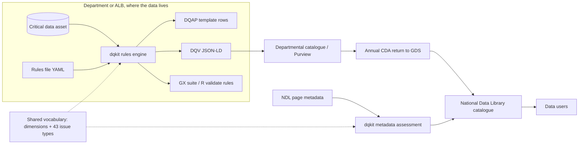
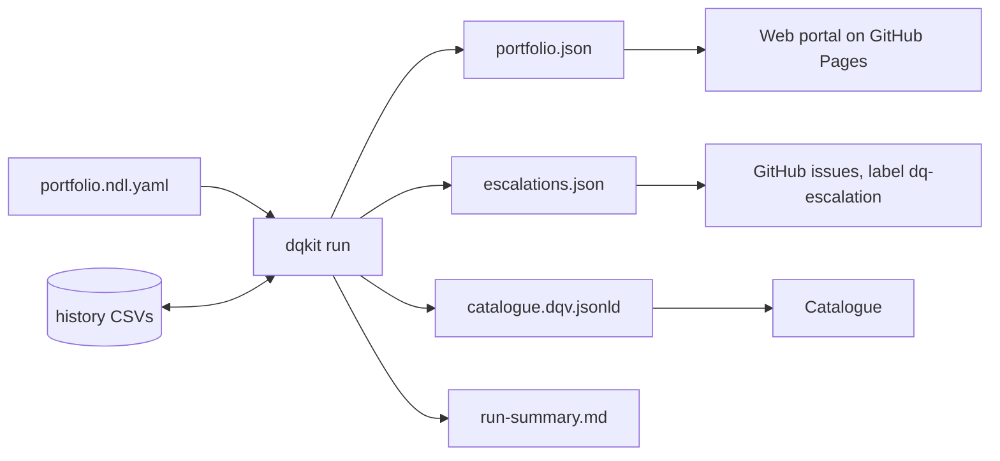

# Architecture: solution, high-level and low-level design

## 1. Solution architecture (SAD)

### Context

### Principles
1. **Data stays with its owner.** The kit runs locally. Only results and metadata move.
2. **One rules file, many outputs.** Steward effort is spent once. Exporters serve other tools.
3. **Standards first:** DCAT, DQV, SKOS, LinkML, JSON Schema, SHACL, ISO 8601, and the GOV.UK issues framework.
4. **Explainable.** Every score carries its evidence, rule and source requirement.
5. **Inclusion by design.** Representativeness is a first-class dimension.

### Fit with the target platform
The recommended production stack (Dataverse, then Fabric, then Purview) can consume DQV JSON-LD as
custom metadata, or map it to Purview data quality rules. The departmental return workspace's Dataverse
table can take the extension's fields as columns (see the LLD mapping).

## 2. High-level design (HLD)

| Component | Responsibility | Interfaces |
|---|---|---|
| `framework.py` | GOV.UK issues framework: targets, bands, priority, resolution | `assess(importance, impact, performance, target)` |
| `rules.py` | Load and validate rule files; run 15 check types on a DataFrame; summarise | `load_rules`, `run(df, spec, as_of)` |
| `metadata.py` | 20 requirement checks on catalogue records; 13 CDA properties; portfolio scoring | `assess_record`, `assess_portfolio` |
| `dqv.py` | Results to W3C DQV JSON-LD | `result_to_dqv` |
| `exporters.py` | Great Expectations, R validate, DQAP CSVs | `to_great_expectations`, `to_r_validate`, `to_dqap_csv` |
| `cli.py` | Plain command line | `check` (with `--workbook`, `--history`), `export`, `assess-metadata`, `run`, `suggest` |
| `portfolio.py` | Run many assets from one portfolio file (`portfolio.schema.json`): per-asset outputs, schedule (due or carried forward), changes since the last run, escalations, merged DQV catalogue, run summary | `run(portfolio_path, as_of, out_dir)`, `validate`, `build_escalations`, `compare` |
| `profile.py` | Profile a data file and draft a starter rules file for a steward to review | `profile(df)`, `suggest(df, asset)`, `to_yaml(spec)` |
| `.github/workflows/dq-pipeline.yml` | Weekly pipeline: tests, `dqkit run`, commit results, GitHub issues per escalation, portal to GitHub Pages | GitHub Actions (schedule, manual run with `as_of`) |
| `portfolio.py`, `cdareturn.py` | Portfolio runner; CDA return rows in the proposed Dataverse columns | `dqkit run`; `cda-return.csv` |
| `portal/src/` and `scripts/build_dq_portal.py` | NDL Data Quality Portal: 8 page templates, shared shell, base CSS; built from the run's results | Static site in `portal/dist/` (GitHub Pages); artifact copy |
| `portal/src/js/engine.js` | Browser port of the kit (checks, scoring, trust, route, ageing, DQV, DQAP CSV) | `DQ.run(table, spec, asOf)`; parity-checked against Python (`scripts/parity_check.py`) |
| `trust.py` | IOPC-style trust level, with reasons | `classify(result)` |
| `pathway.py` | DQAP route from the 2023 decision tree | `route(asset)` |
| `workbook.py` | Filled-in DQAP workbook (11 tabs) and run history | `build`, `append_history` |
| `operations.py` | Issue ageing, overdue escalation (issues framework timescales), recurrence | `assess(result, history_dir)` |
| `casestudy.py` | Draft case study in the GDS Shared Learning Library template | `draft`, `to_markdown`, `to_docx` |
| `survey.py` | DQ tooling survey: Forms export to one row per organisation and solution; personal data dropped | `load`, `reshape`, `summarise` |
| `vocab/` | Dimensions and issue types (CSV source; SKOS and JSON-LD generated) | `scripts/build_vocab.py` |
| `model/` | Proposed metadata extension (LinkML, JSON Schema, SHACL) | For GDS metadata model owners |

## 3. Low-level design (LLD)

### Scoring flow for one rule
1. Pass rate = records passing ÷ records checked × 100.
2. Combined score = asset importance (1–4) × rule impact (1–4). The impact defaults from the issue type.
3. Target = the rule's own target, or the default for the framework range: 85, 95, 99 or 100.
4. If below target, find the band:
   - Middle band starts at 100 − 2 × (100 − target).
   - High band starts halfway between the middle-band start and the target.
   - Score: Low 3, Middle 2, High 1, and 4 when the target is 100.
5. Priority score = importance × impact × band score:
   - 1–7 Low
   - 8–16 Medium
   - 17–32 High
   - 33–64 Critical
6. Resolution comes from Table 8.

### Control points and escalation
- Each rule has a `control_point`: source (capture), pipeline, or reporting. It defaults by check type.
- An issue's age is the number of consecutive measurement cycles below target, read from the history.
- An issue is overdue when its age exceeds its priority's window: Critical 1, High 1, Medium 3, Low 6 (D-026).

### Dataset-level checks
`freshness`, `sum_max` and `group_disparity` give one pass or fail (checked = 1). `freshness` treats a year
label as covering the whole year. It passes when (as_of − end of the latest period) ≤ expected frequency + lag.

### Mapping to the Dataverse return table (proposed new columns)

| Extension slot | Dataverse column | Type |
|---|---|---|
| dqap_status | `gds_dqapstatus` | Choice: none, in_progress, in_place, equivalent |
| data_quality_action_plan | `gds_dqapurl` | URL |
| quality_assessment_date | `gds_dqbaselinedate` | Date |
| quality_measurements (per dimension, mean) | `gds_dq_completeness` … `gds_dq_accuracy` | Decimal (0–100) |
| quality_issues (counts by priority) | `gds_dqissues_critical`, `_high`, `_medium`, `_low` | Whole number |
| inclusion_assessed | `gds_dqinclusionassessed` | Yes/No |

### Operations

The kit runs as a scheduled pipeline (runbook: [`OPERATIONS.md`](OPERATIONS.md)).

- **Portfolio file**: one YAML file lists each asset's rules and data files, with an optional
  schedule and tags. It is checked against `dqkit/portfolio.schema.json` (JSON Schema 2020-12).
- **Determinism**: results depend only on the data, the rules and `--as-of`. `run_at` is the only
  clock value (fixed by `SOURCE_DATE_EPOCH` if set). `fingerprint` hashes what was measured, so the
  pipeline commits only when results change.
- **History**: one CSV per asset. Re-running a date replaces that date's rows (no double counting of cycles).
- **Schedule**: an asset that is not due is carried forward from the last run, without adding a cycle.
- **Changes**: `new`, `resolved` and `still_open` issues compare this run's `portfolio.json` with the previous one in the same folder.
- **Escalation**: priorities in `notify.escalate_priorities` (default Critical, High) that are overdue
  under the issues framework windows (D-026). Who acts comes from the DQAP route.
- **Merged catalogue**: DQV graphs are merged by `@id`. A chart file and its NDL page share an IRI, so
  their measurements sit on one `dcat:Dataset` node.

### Security and privacy
- The kit reads files locally and makes no network calls.
- Failing examples include up to 5 row values. For personal data, set the rule's columns carefully or strip
  `examples` before sharing results. The recommendation is to share only `dqv.jsonld` and the DQAP CSVs.

## 4. v1.0.0 additions (15 October 2026)
- **Knowledge layer:** `knowledge/*.yaml|csv` is the single source for frameworks, clauses, communities, learning, maturity, surveys and AI guidance. The portal build injects it as `__K_NAME__` placeholders; the MCP server and assistant read the same data.
- **Portal:** 19 static pages from `portal/src/pages`, shared shell (grouped navigation, guided-tour engine), parity-checked browser engine.
- **Runtime services (claude.ai artifact):** `db` with 9 access rules (library, wishlist, results readable by all, written by editors; per-member `queue/{self}`, `responses/{self}`, `votes/{self}`); `user` (opaque id only, no names); `sample` for the assistant. On GitHub Pages these resolve to null and the pages fall back to GitHub issue forms.
- **Integration:** GitHub (source of truth) to Jira (`backlog-sync.yml`, `scripts/sync_backlog.py`) and Confluence (`docs-to-confluence.yml`, `scripts/publish_confluence.py`); configuration in `integrations/config.yaml`; secrets only in repository secrets.
- **Agent interface:** `dqkit/mcp_server.py` (stdio JSON-RPC, read-only, root-restricted).
