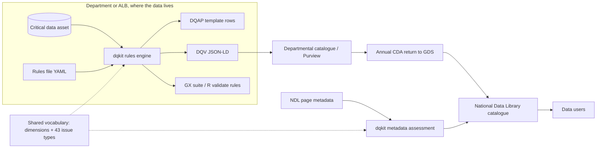
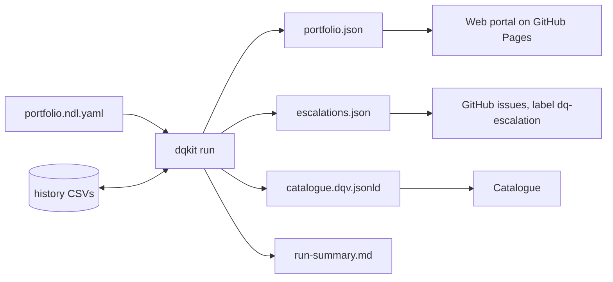
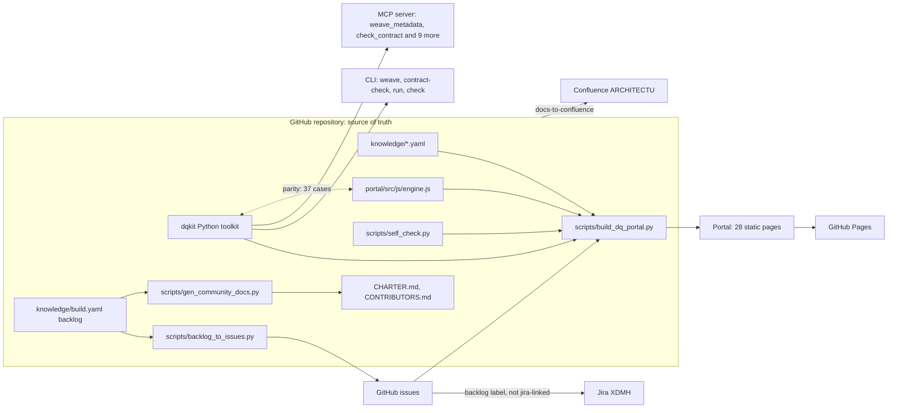

# Architecture: solution, high-level and low-level design

## 1. Solution architecture (SAD)

### Context

### Principles
1. **Data stays with its owner.** The kit runs locally. Only results and metadata move.
2. **One rules file, many outputs.** Steward effort is spent once. Exporters serve other tools.
3. **Standards first:** DCAT, DQV, SKOS, LinkML, JSON Schema, SHACL, ISO 8601, and the GOV.UK issues framework.
4. **Explainable.** Every score carries its evidence, rule and source requirement.
5. **Inclusion by design.** Representativeness is a first-class dimension.

### Fit with the target platform
The recommended production stack (Dataverse, then Fabric, then Purview) can consume DQV JSON-LD as
custom metadata, or map it to Purview data quality rules. The departmental return workspace's Dataverse
table can take the extension's fields as columns (see the LLD mapping).

## 2. High-level design (HLD)

| Component | Responsibility | Interfaces |
|---|---|---|
| `framework.py` | GOV.UK issues framework: targets, bands, priority, resolution | `assess(importance, impact, performance, target)` |
| `rules.py` | Load and validate rule files; run 15 check types on a DataFrame; summarise | `load_rules`, `run(df, spec, as_of)` |
| `metadata.py` | 20 requirement checks on catalogue records; 13 CDA properties; portfolio scoring | `assess_record`, `assess_portfolio` |
| `dqv.py` | Results to W3C DQV JSON-LD | `result_to_dqv` |
| `exporters.py` | Great Expectations, R validate, DQAP CSVs | `to_great_expectations`, `to_r_validate`, `to_dqap_csv` |
| `cli.py` | Plain command line | `check` (with `--workbook`, `--history`), `export`, `assess-metadata`, `run`, `suggest` |
| `portfolio.py` | Run many assets from one portfolio file (`portfolio.schema.json`): per-asset outputs, schedule (due or carried forward), changes since the last run, escalations, merged DQV catalogue, run summary | `run(portfolio_path, as_of, out_dir)`, `validate`, `build_escalations`, `compare` |
| `profile.py` | Profile a data file and draft a starter rules file for a steward to review | `profile(df)`, `suggest(df, asset)`, `to_yaml(spec)` |
| `.github/workflows/dq-pipeline.yml` | Weekly pipeline: tests, `dqkit run`, commit results, GitHub issues per escalation, portal to GitHub Pages | GitHub Actions (schedule, manual run with `as_of`) |
| `portfolio.py`, `cdareturn.py` | Portfolio runner; CDA return rows in the proposed Dataverse columns | `dqkit run`; `cda-return.csv` |
| `portal/src/` and `scripts/build_dq_portal.py` | NDL Data Quality Portal: 8 page templates, shared shell, base CSS; built from the run's results | Static site in `portal/dist/` (GitHub Pages); artifact copy |
| `portal/src/js/engine.js` | Browser port of the kit (checks, scoring, trust, route, ageing, DQV, DQAP CSV) | `DQ.run(table, spec, asOf)`; parity-checked against Python (`scripts/parity_check.py`) |
| `trust.py` | IOPC-style trust level, with reasons | `classify(result)` |
| `pathway.py` | DQAP route from the 2023 decision tree | `route(asset)` |
| `workbook.py` | Filled-in DQAP workbook (11 tabs) and run history | `build`, `append_history` |
| `operations.py` | Issue ageing, overdue escalation (issues framework timescales), recurrence | `assess(result, history_dir)` |
| `casestudy.py` | Draft case study from results | `draft`, `to_markdown`, `to_docx` |
| `vocab/` | Dimensions and issue types (CSV source; SKOS and JSON-LD generated) | `scripts/build_vocab.py` |
| `model/` | Proposed metadata extension (LinkML, JSON Schema, SHACL) | For GDS metadata model owners |

## 3. Low-level design (LLD)

### Scoring flow for one rule
1. Pass rate = records passing ÷ records checked × 100.
2. Combined score = asset importance (1–4) × rule impact (1–4). The impact defaults from the issue type.
3. Target = the rule's own target, or the default for the framework range: 85, 95, 99 or 100.
4. If below target, find the band:
   - Middle band starts at 100 − 2 × (100 − target).
   - High band starts halfway between the middle-band start and the target.
   - Score: Low 3, Middle 2, High 1, and 4 when the target is 100.
5. Priority score = importance × impact × band score:
   - 1–7 Low
   - 8–16 Medium
   - 17–32 High
   - 33–64 Critical
6. Resolution comes from Table 8.

### Control points and escalation
- Each rule has a `control_point`: source (capture), pipeline, or reporting. It defaults by check type.
- An issue's age is the number of consecutive measurement cycles below target, read from the history.
- An issue is overdue when its age exceeds its priority's window: Critical 1, High 1, Medium 3, Low 6 (D-026).

### Dataset-level checks
`freshness`, `sum_max` and `group_disparity` give one pass or fail (checked = 1). `freshness` treats a year
label as covering the whole year. It passes when (as_of − end of the latest period) ≤ expected frequency + lag.

### Reading numbers and outliers
Numbers are read by `dqkit/numbers.py` (mirrored by `pdNumber` in `engine.js`), not by pandas, so results do not
change with the pandas version (D-TK-02). `outlier` counts only cells that are numbers; blanks and text are left to
`not_null` and `type`. With `method: iqr` a value fails outside Q1 − k·IQR to Q3 + k·IQR (numpy's linear quantile,
written out in both engines); with `method: zscore` it fails more than `threshold` sample standard deviations from
the mean. Fewer than 4 numbers: nothing to compare, so every value passes.

### Mapping to the Dataverse return table (proposed new columns)

| Extension slot | Dataverse column | Type |
|---|---|---|
| dqap_status | `gds_dqapstatus` | Choice: none, in_progress, in_place, equivalent |
| data_quality_action_plan | `gds_dqapurl` | URL |
| quality_assessment_date | `gds_dqbaselinedate` | Date |
| quality_measurements (per dimension, mean) | `gds_dq_completeness` … `gds_dq_accuracy` | Decimal (0–100) |
| quality_issues (counts by priority) | `gds_dqissues_critical`, `_high`, `_medium`, `_low` | Whole number |
| inclusion_assessed | `gds_dqinclusionassessed` | Yes/No |

### Operations

The kit runs as a scheduled pipeline (runbook: [`OPERATIONS.md`](OPERATIONS.md)).

- **Portfolio file**: one YAML file lists each asset's rules and data files, with an optional
  schedule and tags. It is checked against `dqkit/portfolio.schema.json` (JSON Schema 2020-12).
- **Determinism**: results depend only on the data, the rules and `--as-of`. `run_at` is the only
  clock value (fixed by `SOURCE_DATE_EPOCH` if set). `fingerprint` hashes what was measured, so the
  pipeline commits only when results change.
- **History**: one CSV per asset. Re-running a date replaces that date's rows (no double counting of cycles).
- **Schedule**: an asset that is not due is carried forward from the last run, without adding a cycle.
- **Changes**: `new`, `resolved` and `still_open` issues compare this run's `portfolio.json` with the previous one in the same folder.
- **Escalation**: priorities in `notify.escalate_priorities` (default Critical, High) that are overdue
  under the issues framework windows (D-026). Who acts comes from the DQAP route.
- **Merged catalogue**: DQV graphs are merged by `@id`. A chart file and its NDL page share an IRI, so
  their measurements sit on one `dcat:Dataset` node.

### Security and privacy
- The kit reads files locally and makes no network calls.
- Failing examples include up to 5 row values. For personal data, set the rule's columns carefully or strip
  `examples` before sharing results. The recommendation is to share only `dqv.jsonld` and the DQAP CSVs.

## 4. v1.0.0 additions (15 October 2026)
- **Knowledge layer:** `knowledge/*.yaml|csv` is the single source for frameworks, clauses, communities, learning, maturity, surveys and AI guidance. The portal build injects it as `__K_NAME__` placeholders; the MCP server and assistant read the same data.
- **Portal:** 19 static pages from `portal/src/pages`, shared shell (grouped navigation, guided-tour engine), parity-checked browser engine.
- **Runtime services (until v2.3.0):** pages used claude.ai's shared store and model when opened there. Removed in v2.3.0 (D-GH-02): every interaction now runs on GitHub (issue forms, reactions, labels, Actions) and the portal's own code. See section 6.
- **Integration:** GitHub (source of truth) to Jira (`backlog-sync.yml`, `scripts/sync_backlog.py`) and Confluence (`docs-to-confluence.yml`, `scripts/publish_confluence.py`); configuration in `integrations/config.yaml`; secrets only in repository secrets.
- **Agent interface:** `dqkit/mcp_server.py` (stdio JSON-RPC, read-only, root-restricted).

## 5. v1.1.0 additions (15 October 2026)
- **Toolkit:** `dqkit/contracts.py` (ODCS, Table Schema, CSVW), `dqkit/reconcile.py`; both mirrored in `portal/src/js/engine.js` and parity-checked with the exporters.
- **Browser file reading:** `portal/src/js/sheets.js` reads xlsx and ods with DecompressionStream and DOMParser; no third-party code.
- **Knowledge layer:** adds `commercial.yaml`, `legacy.yaml`, `interop.yaml`, `rosetta.yaml`, `articles.yaml`, `media.yaml`; every file carries `review: {last_reviewed, owner_role}`.
- **Shared store:** adds a `media` collection (read by all, written by editors); maturity benchmarks are stored per member under `responses/{self}` and published to `results/maturity`.
- **Operations:** `link-check.yml` monthly; `scripts/mcp_manifest.py` generates `integrations/ndl-mcp-domain.json`.

## 6. v1.2.0 design (15 October 2026)

### 6.1 Solution view (SAD)

- **Scope widened:** users now include the Crown Dependencies, Overseas Territories, Commonwealth partners and international bodies. Nothing in the toolkit assumes UK law; frameworks are chosen per jurisdiction through packs (now 14, including `un-nqaf` and `imf-dqaf`).
- **Quality attributes added:** self-assurance (the content health check fails the build on personal data, mismatched claims and overdue reviews), provenance (every page states when its content was last reviewed and by which role), and privacy by default for contact (no email address published or required).
- **Source of truth:** the GitHub repository. Jira (XDMH) and Confluence (ARCHITECTU) are mirrors, updated by workflows or by hand with the sync status recorded in the build log.

### 6.2 High-level design (HLD)

### 6.3 Low-level design (LLD)

**Metadata Weaver (`dqkit/weaver.py`, `DQ.weaver`).**
1. `detect(record)`: ODCS if `kind: DataContract` or `apiVersion`; DCAT if a `dcat:` type, context or key; schema.org if `@type: Dataset`; CKAN if package keys (also inside an API `result`).
2. `read_<format>` fills a canonical record of 22 fields (`FIELDS`: key, label, Rosetta concept, CDA property, which outputs carry it). Lists are de-duplicated; nothing is inferred.
3. `to_dcat`, `to_schema`, `to_ckan`, `to_odcs` write only filled fields. DCAT uses `dqc:` for security classification and expiry. ODCS needs an id and version, so it uses visible placeholders (`dataset`, `1.0.0`).
4. `coverage()` lists filled, missing and "not carried" fields per output; `cda_check()` scores the 13 CDA properties (description needs 40 characters; distributions need a format) with half credit for partial.

**Contract change control (`dqkit/contracts.py`).**
- `validate_odcs`: errors for missing required fields, wrong kind, unnamed schema objects or properties, repeated property names; warnings for non-v3, unknown status, non-semantic version, no schema, unknown metrics, rules without thresholds, no team, no SLA.
- `diff_odcs`: columns keyed by (object, property). Breaking: removed column, changed type, lost `required` or `unique`, removed quality rule, looser threshold, status moved to deprecated or retired. Suggests major, minor or patch; `version_ok` says whether the stated version is a big enough bump.

**Content health (`scripts/self_check.py`).** Eight checks, each finding an error, warning or note; writes `health.json` and `health.md`; exit 1 on errors (or warnings with `--strict`). The build embeds a summary in Help us build this. The weekly workflow keeps one GitHub issue open while there are findings.

**Contact and moderation.** The sender's message is an item of kind `contact` in their own `queue/{uid}` document (rules: owner read and write, editors read all). Moderators reply in place (`status: answered`, `reply`), which the sender sees on Help us build this. No email field exists.

**Provenance.** At build time each page's `__K_NAME__` placeholders are mapped to knowledge files; the oldest `review.last_reviewed` and the owning roles are printed above the colophon.

**Backlog to issues.** Idempotent: existing issues are matched by `[BL-nn]`. Items with a Jira key get `jira-linked`, which the Jira sync workflow skips.

## 7. v1.3.0 design (15 October 2026)

**Knowledge graph (`dqkit/graph.py`).** Builds nodes (`Type:slug`) and named edges from every knowledge file, the vocabulary CSVs, packs and the Rosetta. Every edge's property is declared in `knowledge/ontology.yaml` with a domain and range (a test enforces this), so the graph is self-describing. Bridging links come only from the data: glossary terms that name a dimension, role or standard are `sameAs` it; lineage stages `involve` the concepts they use; places are `inScope` of the Commons. Result: 460 nodes, about 1,060 edges, one connected component, no dangling links. Exports: JSON for the portal, JSON-LD and Turtle (SKOS concepts, OWL classes and object properties, `owl:sameAs` to the published vocabulary IRIs). Questions: `find`, `neighbours`, `path` (breadth-first, either direction).

**Knowledge map page.** Radial neighbourhood view (SVG, no libraries) with keyboard-focusable nodes and a full relationship list as the accessible equivalent; trail; path finder; glossary A to Z; ISO 25964 thesaurus (SN, UF, BT, NT, RT, USE); data dictionary with an entity relationship diagram; taxonomies as nested disclosures; ontology class diagram; lineage diagrams laid out by longest-path layering; framework-to-evidence traceability.

**Events.** Curated events plus published community events (`events/{id}`, moderated from each member's queue). RFC 5545 calendar files generated in the browser.

**Releases.** `knowledge/releases.yaml` drives the version, the What's new drawer (a non-modal dialog that keeps focus, closes on Escape and remembers the last version seen in local storage) and New or Updated flags in menus.

**Bundle.** `scripts/build_bundle.py` converts the mandated Markdown documents with a small built-in converter into one standalone page; `--check` keeps the committed copy current.

## 8. v1.4.0 design (30 October 2026)

**Playbook.** `knowledge/playbook.yaml` is the single source. The portal build exposes it as `__K_PLAYBOOK__`; the page joins it with `__K_REQUIREMENTS__` (clause text) and `__K_FRAMEWORKS__` (jurisdiction finder) in the browser. `scripts/build_playbook_doc.py` renders the same data as Markdown for the build bundle. The playbook cycle is a lineage flow in `knowledge/ontology.yaml`, so the graph links each stage to the toolkit stages and glossary terms it uses.

**Verification states.** `verified`/`checked` now take `yes`, `partly`, `listed` or `unpublished`; `checked_on` records the date read. The health check counts `yes` and `unpublished` as read in full.

## 9. v1.5.0 design (30 October 2026)

**Playbook in the toolkit.** `dqkit/playbook.py` reads `knowledge/playbook.yaml`. A workspace is a plain folder: six CSV templates named by stage, a README checklist and `playbook-status.yaml` (asset ID, rules file, results folder). `status()` checks evidence per stage and parses README ticks. The CLI and MCP tool are thin wrappers; MCP confines workspace paths with the existing `_inside()` guard.

**Publishing and releases.** `pages.yml` (push to main) and the weekly pipeline both build `portal/dist` and copy `docs/bundle/index.html` to `/bundle/` before deploying. `release.yml` runs the tests, renders notes with `scripts/release_notes.py` and creates the release with a `git archive` zip.

## 10. v1.6.0 design (30 October 2026)

**Stakeholders and brief.** `knowledge/stakeholders.yaml` (roles, dates, gaps) is joined at build time with `dqkit.effort.scenarios()` and a summary of `assessments/portfolio/cda-return.csv` into `__K_STAKEHOLDERS__`. The brief is therefore regenerated on every build and release.

**Q-FAIR.** `dqkit/qfair.py` rates five areas from the run result and the asset record; `cdareturn.row()` adds the record fields, ratings and baseline confidence. New optional asset fields in rules files: `description`, `access_route`, `classification`, `conforms_to`, `identifiers`, `licence`, `provenance`, `baseline_confidence`.

**Effort.** `knowledge/effort.yaml` holds activities and defaults; the baseline page reads it through `__K_EFFORT__`; `dqkit/effort.py` ports the same formula.

## 16. v2.13.0: connectors, weaves and AI (7 November 2026)
- `dqkit/weaves.py` turns a rules spec into native text for 11 targets through one shared `passes(rule, dialect)` function that writes a row-level pass condition per SQL dialect (ANSI, Snowflake, Spark, BigQuery); aggregate checks (uniqueness, sums, freshness) are handled per target. `engine.js` mirrors it as `DQ.weaves`; `scripts/parity_check.py` compares both on every fixture.
- `weaves.crosswalk()` runs each weave on a one-rule sample per check type and classifies the result (native, SQL, none); the build passes it to `connectors.html` with `knowledge/vendors.yaml` as `__K_VENDORS__`.
- Entry points: the page (offline, in the browser), `python3 -m dqkit export --to <target>`, and the MCP tool `weave_rules`.
- `scripts/check_vendor_repos.py` (GitHub search API) runs in the monthly link-check workflow and joins its single tracked issue.

## 15. v2.12.0: participation, governance, display and labels (5 November 2026)
- **Knowledge:** `participation.yaml` (`__K_PARTICIPATION__`), `governance-bodies.yaml` (`__K_GOVBODIES__`), `code-evidence.yaml` (`__K_CODE__`, written by `scripts/import_code_evidence.py`); `playbook.yaml` stages gain `dam_playbooks`; `ecosystem.yaml` gains `xref.requirements`; `feedback.yaml` gains `sister_routes` and `cross_portal`.
- **Build:** copies `portal/src/badges/` to `badges/`; `ambassador_kit()` writes `downloads/getinvolved/`; writes `downloads/weaver-uk-mem-mapping.csv`; `{{REPO}}` replaced in pages; `api/xref.json` adds `dam_requirements`.
- **Shell:** display options panel and early-apply script (`dqp-display` in localStorage); source labels (`.dqp-src`, classified by hostname, re-run on page changes); journey bar (`dqp-journey`); reflow rules for large text; menu breakpoint 1440 pixels.
- **Pages:** `getinvolved.html`, `governance.html` (46 pages in total).

## 14. v2.11.0: research and open roadmap (5 November 2026)
- **Knowledge:** `knowledge/research.yaml` feeds `__K_RESEARCH__` (plus `email_text` from `research_email()`); `knowledge/roadmap.yaml` feeds `__K_ROADMAP__` with the backlog from `build.yaml` and live GitHub votes (`github_live()`). Both are searchable and published under `api/knowledge/` (D-UR-02, D-RM-01).
- **Scoring:** weighted mean of four 0 to 3 criteria times an effort factor; the band sets MoSCoW in `build.yaml` (tested), so `roadmap()` and `scripts/backlog_to_issues.py` keep using MoSCoW and status unchanged. The page recomputes scores in the browser only for the what-if view.
- **Bundle:** `research_bundle()` writes five documents and a zip to `downloads/research/` with python-docx and the standard library `email` package; no sender, recipients or tracking.
- **Pages:** `research.html`, `roadmap.html` (44 pages in total).

## 13. v2.10.0: standards catalogue, DQV and the three-portal ecosystem (5 November 2026)
- **Knowledge:** `knowledge/standards-catalogue.yaml` (sources, domains, 57 standards) feeds `__K_STANDARDS__` on `interop.html`; `knowledge/ecosystem.yaml` (portals, comparison, gains, join-up, xref maps, lineage nodes and edges, journeys, placements) feeds `__K_ECO__` on `ecosystem.html`, `wheel.html` and `roles.html`. Both are searchable (D-STD-01, D-ECO-01).
- **Weaver:** `to_dqv()` / `W.toDqv` produce a `dqv:QualityMetadata` graph from coverage, CDA check and profile results; `weave()` returns `quality`; CLI `weave --to dqv` (D-DQV-02).
- **Build:** `related_elsewhere(stem)` adds a "Continue in a sister portal" aside to pages listed in `placements`; `xref_manifest()` writes `api/xref.json` (keys: dama_areas, roles, standards, pages; related portals and their manifests).
- **Interfaces with sister portals:** links only, by shared key and stable anchor (`capability-model.html#dm-xx`, `together.html#role-CODE` in the playbooks; `#dama`, `#standards`, `#guide` in the catalogue). The live check on `ecosystem.html` reads the playbooks' `data/xref.json` from the same github.io origin; failure shows a message and the links still work.
- **Pages:** `ecosystem.html` (42 pages in total).

## 12. v2.9.0: wheel, change roles and feedback (5 November 2026)
- **Knowledge:** `dama-wheel.yaml` (`__K_WHEEL__`), `change-delivery.yaml` (`__K_CHANGE__`), `feedback.yaml` (`__K_FEEDBACK__`); all three feed search and Ask the Commons through `SEARCH_SOURCES`.
- **Pages:** `wheel.html` reads `__K_WHEEL__`, `__K_MATURITY__` and `__K_COMMUNITIES__`; the overlay reads the visitor's `dqc.maturity` answers from their browser, and join-up ticks are kept in `dqc.joinup`. `roles.html` reads `__K_CHANGE__` and groups roles by `group`.
- **Build:** `feedback_strip()` adds the feedback aside before the previous and next links on every page (the Microsoft Form link only when configured; pre-filled link with PAGE replaced by the page name); `feedback_docx()` writes the question set to downloads (python-docx).
- **Tests:** `tests/test_wheel_change_feedback.py` checks mappings, one accountable role per RACI activity, role and anchor clashes, blueprint completeness and the form's privacy rules.

## 11. v2.8.0: reading aids, site map, Ask, share and reuse (5 November 2026)
- **Shell:** visual layer CSS and a reading-aids script (section hues, column fitting, scroll cues, acronyms, tooltips, progress, Top) that runs after the page draws and again, debounced, when a page redraws (MutationObserver); a share and embed script. Group key comes from the build (`data-group` on `.wrap`, `data-g` on menu groups) (D-VIS-01, D-SHARE-01).
- **Build:** `prev_next()` adds page navigation; `site_map()` and `mcp_tools()` feed `__K_SITEMAP__` and `__K_MCPTOOLS__`; `knowledge/reuse.yaml` feeds `__K_REUSE__`; `{{ACRONYMS}}` from `knowledge/acronyms.yaml`; `write_api()` writes `api/`, `feed.xml`, `sitemap.xml` and `ask-index.js` (passages collected by `search_index()`) (D-REUSE-01, D-AI-02).
- **Pages:** `sitemap.html`, `ask.html`, `reuse.html` (40 pages in total).
- **Embed contract:** `?embed=1` hides the bar, footer, page navigation and floating buttons; `&accent=` accepts six hex digits only; the page posts `{type: "dqp-height", height}` to its parent every second when its height changes.

## 9. v2.7.0: catalogues and quality tools (5 November 2026)
- **Knowledge:** `knowledge/catalogue-integration.yaml` (patterns, depth, products with sources and checked dates, standards, risks, rfx, poc, exit, steps, routes, related), fed to `catalogues.html` as `__K_CATALOGUES__` and to search.
- **Cross-page:** `commercial.html#add=<clause ids>` adds clauses to the schedule; risks and the exit checklist use it (D-COM-02).
- **Client-side only:** checker answers, selections and ticks stay in the browser (localStorage, guarded); downloads are generated in the browser.

## 8. v2.6.0: the model as navigation (4 November 2026)
- **Navigation fields** in `models/dq-capability.yaml`: `pages` (capability), `page` and `stage` (step), `lanes` (swimlane to stakeholder and learning role). Validated by `build_models.py` against `portal/src/pages`, `knowledge/playbook.yaml`, `stakeholders.yaml` and `learning.yaml` (D-NAV-02).
- **Feeds:** `__K_MODELS__` (full, models page) and `__K_MODELNAV__` (light: capabilities, lanes, steps; home, roles, playbook).
- **Models page:** SVG drawn in the browser with the same layout and routing rules as the Visio and BPMN exports; deep links `#cap-`, `#wf-`, `#ent-`.
- **Search and graph:** `search_index()` adds capability, record, workflow and step entries; `dqkit/graph.py` adds `Capability`, `Workflow`, `RecordType` nodes linked to frameworks, roles and each other.
- **Shell:** `placePanel()` keeps menu panels on screen; two-column panels for long groups; full menu from 1300px (D-NAV-01).

## 7. v2.5.0: capability and data models (4 November 2026)
- **Source:** `models/dq-capability.yaml` (capabilities, entities, reference lists, workflows, guidance codes). **Generator:** `scripts/build_models.py`, deterministic, `--check` in CI (D-MOD-01).
- **Information architecture:** 22 record types in 7 groups: Governance (Organisation, RoleAssignment); Asset and metadata (DataAsset, Distribution, DataSharingAgreement, MetadataRecord); Requirements (DataItem, UserNeed, DataQualityActionPlan); Measurement (QualityRule, MeasurementRun, RuleResult); Issue management (Issue, RootCause, RemediationAction, Escalation); Reporting (CommunicationPlanEntry, QualityStatement); Assurance (AssetReturn, AnnualReview, Requirement, MaturityAssessment). They match the DQAP workbook tabs, CDA return columns and DQV output the toolkit already produces.
- **Exports:** ArchiMate exchange and Archi CSV (`models/out/archimate`), UML XMI, SQL, JSON Schema, OWL, CSV dictionary and matrix, ERD, Visio (`.vsdx` written as Open Packaging XML, rendered to PDF and previews by LibreOffice with `--render`), BPMN 2.0 with diagram interchange. The workflow layout is computed once and shared by the Visio, BPMN and ArchiMate views.
- **Portal:** `models.html` reads the YAML at build time (`models_summary()`); the build copies the exports to `downloads/models/` and zips them.

## 6. v2.3.0: GitHub only, no claude.ai dependency (4 November 2026)
The portal must work for every audience, most of whom have no claude.ai licence (D-GH-02).
- **Send:** every form opens a pre-filled GitHub issue form through `window.DQP_GITHUB` (shell). Forms: contact, wish, bug,
  rule or pack, commission, contribution (resources, case studies, events, blogs, videos, podcasts), maturity share, and one per
  survey. Survey and maturity forms are generated from the knowledge base by `scripts/gen_issue_forms.py`.
- **Moderate:** moderators add the `published` label (or `withdrawn`). Triage flags waiting items.
- **Show:** the portal build reads issue data once with a read-only token (`github_live()`, `community()` in
  `scripts/build_dq_portal.py`): backlog states and 👍 votes, the wishlist, published contributions, survey totals and the maturity
  benchmark (counts under 5 hidden; free text never read). The publish workflow runs on every push, on issue events and daily.
- **Draft rules:** the rules assistant turns plain English into rules with fixed patterns, entirely in the browser; an optional
  button copies a prompt for an AI tool the person's organisation has approved. No AI service is called by the Commons.
- **Unchanged:** visitors' browsers never call GitHub or anyone else (D-POL-01); the offline zip still works, showing the data as of its build.
