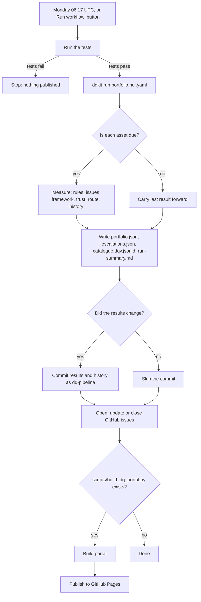

# Operations runbook: the data quality pipeline

This runbook is for the people who look after the pipeline day to day. You do not need to be a
developer. Where you need to type a command, it is shown in full, ready to copy and paste.

> **Status: untested on GitHub.** The two workflow files (`.github/workflows/dq-pipeline.yml` and
> `.github/workflows/ci.yml`) have been checked by the kit's tests (their structure and required
> settings), but GitHub Actions cannot run until the repository is pushed to GitHub. Expect to fix
> small problems on the first real run. Everything else in this runbook (`dqkit run`, `dqkit suggest`,
> the output files) has been run and tested locally.

## 1. What the pipeline does

Once a week (Monday, 06:17 UTC), GitHub runs the pipeline for you. It:

1. **Checks the kit works** by running the automated tests. If they fail, it stops, so it never
   publishes wrong results.
2. **Measures every asset** listed in the portfolio file (`portfolio.ndl.yaml`): it runs each asset's
   rules file on its data file, scores the results with the GOV.UK data quality issues framework,
   and works out a trust level, the DQAP route, and how long each issue has been open.
   Assets with a `schedule` are only re-measured when they are due (see section 6).
3. **Assesses the catalogue records** (the 84 NDL data pages) against GOV.UK requirements.
4. **Saves the results** back into the repository, but only if something really changed.
5. **Raises escalations** as GitHub issues: one issue per asset and rule. It comments on an issue
   that is still open, and closes issues that are now fixed.
6. **Publishes the NDL Data Quality Portal** to GitHub Pages. `scripts/build_dq_portal.py` builds it from this run's results into `portal/dist/`.



### The files it writes (in `assessments/portfolio/`)

| File | What it is | Who uses it |
|---|---|---|
| `run-summary.md` | A plain-English digest: assets, new, resolved and overdue issues | Everyone. Start here. |
| `portfolio.json` | A compact summary of every asset, for the web portal | The portal |
| `escalations.json` | One entry per escalated issue, with a ready-written ticket body | The pipeline (GitHub issues) |
| `catalogue.dqv.jsonld` | All results as W3C Data Quality Vocabulary, one file | Catalogues (for example Purview) |
| `metadata-assessment.json` | Record-by-record results for the 84 catalogue pages | Analysts |
| `assets/` | Per asset: results, DQAP workbook (.xlsx), DQAP CSVs, DQV, draft case study (.md, .docx) | Data stewards |
| `history/` | One CSV per asset: every measurement, so trends and ageing can be tracked | The kit |
| `cda-return.csv` | One row per asset in the proposed Dataverse return columns (gds_*) | Whoever compiles the CDA return |

## 2. How to switch it on (once the repository is on GitHub)

You need to be an administrator of the repository.

1. **Push the repository to GitHub** (the lead does this).
2. **Turn on Actions.** Go to the repository's **Settings → Actions → General**. Under
   "Actions permissions", choose **Allow all actions and reusable workflows**. Under "Workflow
   permissions", choose **Read and write permissions**, so the pipeline can save results and open issues.
3. **Turn on GitHub Pages.** Go to **Settings → Pages**. Under "Build and deployment", set
   **Source** to **GitHub Actions**. (Not "Deploy from a branch".) Two workflows publish the portal:
   `publish portal` (pages.yml) on every push to `main`, and the weekly pipeline after it refreshes results.
   The build bundle is published at `/bundle/`.
   **Releases:** pushing a tag such as `v1.5.0` runs `release` (release.yml), which checks the version is in
   `knowledge/releases.yaml` and creates the GitHub release with notes and a source zip.
4. **Issue label.** The pipeline creates the `dq-escalation` label itself the first time it needs it.
   If you want to create it by hand: **Issues → Labels → New label**, name `dq-escalation`.
5. **Run it once by hand** to check it works: **Actions → Data quality pipeline → Run workflow**.
   Leave the date blank for today. Watch the run; every step has a plain-English name.
6. If the default branch is protected, allow the `github-actions[bot]` to push, or the
   "Save the results" step will fail. Alternatively, remove that step and rely on the downloadable
   copy ("dq-portfolio-results" on the run page).

## 3. How to run it by hand on your own computer

In a terminal, in the repository folder:

1. Install the libraries once: `pip install -r requirements.txt`
2. Run the whole portfolio:
   `python -m dqkit run portfolio.ndl.yaml --out assessments/portfolio`
3. Read `assessments/portfolio/run-summary.md`.

Useful options:

| Option | What it does |
|---|---|
| `--as-of 2026-10-14` | Measure as if on that date. The same date always gives the same results. |
| `--out my-folder` | Write results somewhere else (for a trial run that does not touch the real history). |
| `--no-history` | Do not read or add to the history. Issue ageing and escalation then see only this run. |
| `--ignore-schedule` | Measure every asset now, even ones that are not due. |
| `--fail-on-escalation` | Finish with exit code 2 if anything needs escalating (for automation). |

Exit codes: **0** all OK, **1** a problem (the message names the asset and what is wrong),
**2** escalations found (only with `--fail-on-escalation`).

Running the same date twice is safe: the history keeps one set of rows per date.

To see the results in the portal, build it: `python scripts/build_dq_portal.py`, then open
`portal/dist/index.html`. To refresh the claude.ai copy, add `--artifact some-folder` and publish
that folder's `index.html` with the other pages as its files.

## 4. How to add an asset to the portfolio

1. Put the data file in the repository (for example `assessments/ndl/chart-data/my-file.csv`).
2. Write a rules file for it, or draft one with `dqkit suggest` (section 5).
3. Add one line under `assets:` in `portfolio.ndl.yaml`:
   ```yaml
   - {rules: rules/ndl/my-asset.yaml, data: assessments/ndl/chart-data/my-file.csv, schedule: quarterly, tags: [people]}
   ```
   - `schedule` is optional: `weekly`, `monthly`, `quarterly` or `annual`. Leave it out to measure on every run.
   - `enabled: false` pauses an asset without deleting it.
4. Check it: `python -m dqkit run portfolio.ndl.yaml --out /tmp/try-it`. If something is wrong you
   get a message such as `Asset 9 (rules/ndl/my-asset.yaml): the data file 'my-file.csv' was not found`.
5. Commit the data file, the rules file and the portfolio change together.

The portfolio file is checked against `dqkit/portfolio.schema.json`. History is kept in the
`history_dir` folder, which is inside the output folder (`assessments/portfolio/history`).

## 5. How to start a new asset with `dqkit suggest`

`dqkit suggest` looks at a data file and drafts a rules file for you:

```
python -m dqkit suggest assessments/ndl/chart-data/people__births.csv --title "Births" --owner "Office for National Statistics" --out rules/ndl/my-births.yaml
```

It looks at each column (missing values, number of different values, whether it holds years,
dates, numbers, a short list of codes, or UK geography codes such as E06000001) and suggests:

- `required_columns` for all columns, and `not_null` for columns that are almost never empty
- `unique` for the probable key (a column, or pair, that never repeats)
- `type` for numbers, years and dates; `in_set` for short code lists; `regex` for geography codes
- `no_gaps` and `freshness` for years and periods (`expected: P1Y`, which you must confirm)
- `header_has_unit` for measure columns (this one often fails: it is a real, common issue)
- `not_unknown`, and a commented-out `group_disparity` example, when a column looks like a personal
  characteristic (sex, gender, ethnicity, age, disability, religion), as an inclusion prompt

The draft is designed to pass on the data it came from ("green, then tighten"). **A data steward
must review it:** replace every `[steward to confirm]` with the rule's purpose, confirm importance
and the freshness settings, delete rules that do not matter, add business rules (ranges,
comparisons), and tighten.

## 6. What "due", "open" and "overdue" mean

- **Measurement cycle**: one measurement of an asset. With `schedule: quarterly`, the weekly pipeline
  measures the asset about every 13 weeks; in between, it carries the last result forward and does
  not count a new cycle. (Due after: weekly 6 days, monthly 28, quarterly 89, annual 364.)
- **Open**: a rule is below its target. "Cycles open" is how many measurements in a row it has been below target.
- **Overdue**: open for longer than the GOV.UK data quality issues framework allows for its priority:

  | Priority | Framework resolution | Overdue when open for more than |
  |---|---|---|
  | Critical | Immediately | 1 cycle (the kit treats "immediately" as "by the next measurement") |
  | High | Within 1 measurement cycle | 1 cycle |
  | Medium | Within 3 measurement cycles | 3 cycles |
  | Low | Within 6 measurement cycles | 6 cycles |

## 7. What happens on escalation, and who acts

An issue is **escalated** when its priority is in `notify.escalate_priorities` (Critical and High for
the NDL portfolio) and it is overdue. (Set `notify.escalate_when: open` to escalate as soon as such
an issue appears.)

For each escalation the pipeline opens one GitHub issue, titled `[DQ] <asset id> <rule id>: <issue> (<priority>)`,
labelled `dq-escalation`. The body says, in plain English, what failed, the performance against the
target, how long it has been open, who acts, and the suggested next step. On later runs it adds a
comment (once per new measurement). When the rule meets its target again, it closes the issue with
a comment. If it comes back later, a new issue opens and the kit counts it as a recurrence.

Who acts depends on the DQAP route (from the 2023 decision tree, set in the rules file by `source` and `influence`):

| Route | Who acts | What they do |
|---|---|---|
| Internal data | **Data owner**, and the **governance board** when Critical or High is overdue | Fix the root cause in your own process or system; record cause and action in the DQAP workbook |
| External data, some influence | **Data owner** (and governance board), working with the **supplier** | Agree the fix with the supplier; record it in the DQAP actions |
| External data, no influence (all NDL charts today) | **Data owner** (and governance board) records and communicates; the **supplier** fixes | Tell the supplier, caveat the data for users, record the limitation in the metadata and DQAP |

Whoever is assigned the GitHub issue should: open the asset's DQAP workbook (`assets/<id>.DQAP.xlsx`),
fill in the Causes and Actions tabs, and close the loop at the next measurement.

## 8. Known limits

- **Data files are local.** The pipeline measures the files that are in the repository. It does not
  download fresh data from the source.
- **No automatic refresh yet.** A scheduled run re-measures the same files unless someone updates them.
  Only time-based rules (`freshness`, `not_future`) change on their own as the date moves on.
- **Proposed refresh step.** Add an optional `source_url` to each asset in the portfolio file and a
  new workflow step, before "Measure the portfolio", that runs a small `scripts/refresh_data.py`:
  1. download each `source_url` to a temporary file;
  2. check it is a CSV that `pandas` can read and that it still has the columns the rules file needs
     (the `required_columns` rule);
  3. only then replace the file in the repository, and record the download date and a checksum in
     `assessments/portfolio/sources.json` (provenance);
  4. if a download fails, keep the old file and record the failure, so the run still completes and
     the freshness rule shows the data is getting old.
  The refreshed files are then committed with the results, so every result can be traced to the exact data measured.
- **Pages and issues need GitHub settings** (section 2). Without them the run still measures and
  saves results, but those steps fail.
- **History lives in the repository.** If two people run the pipeline into `assessments/portfolio`
  with different dates and both commit, merge the history CSVs carefully (each row has a date).
- **Size.** `catalogue.dqv.jsonld` is about 2.4 MB because it includes the 84 catalogue pages.

## 9. Troubleshooting

| What you see | Likely cause | What to do |
|---|---|---|
| `Problem: ... has 1 problem(s): Asset 3 (rules/...): 'data' is a required property` | A line in the portfolio file is missing a field | Add the missing field to that asset's line |
| `Problem: Asset 2 (...): the data file '...' was not found` | Wrong path, or the file was not committed | Check the path is relative to the portfolio file, and commit the file |
| `Problem: Asset 4 (...): the rules file has a problem: rule R3: unknown check 'not_nul'` | Typo in the rules file | Fix the check name (see README for the list of checks) |
| `... is not one of ['weekly', 'monthly', 'quarterly', 'annual']` | Unknown schedule | Use one of the four values, or remove `schedule` |
| Run says `not due (quarterly)` for every asset | The schedule has not come round | Expected. Use `--ignore-schedule` to measure now |
| The workflow's tests step fails | The kit or a rules file is broken | Run `python -m unittest discover -s tests` locally and fix before re-running |
| "Save the results" fails with `rejected` or `403` | Workflow permissions are read-only, or the branch is protected | Settings → Actions → General → Read and write permissions; or allow the bot to push |
| No GitHub issues appear | No overdue Critical or High issues (normal for a first run), or `issues: write` not allowed | Check `escalations.json`; check workflow permissions |
| "Publish the portal" is skipped | `scripts/build_dq_portal.py` failed or did not create `portal/dist/index.html` | Run `python scripts/build_dq_portal.py` locally and read the error |
| Deploy fails with "Pages not enabled" or "environment protection" | Pages source is not "GitHub Actions" | Settings → Pages → Source: GitHub Actions |
| The weekly run did not commit anything | Nothing measured changed (the fingerprint in `portfolio.json` is the same) | Expected. The run page still has a downloadable copy |
| Scheduled runs stopped | GitHub pauses scheduled workflows after 60 days with no repository activity | Make any commit, or press "Run workflow" |
